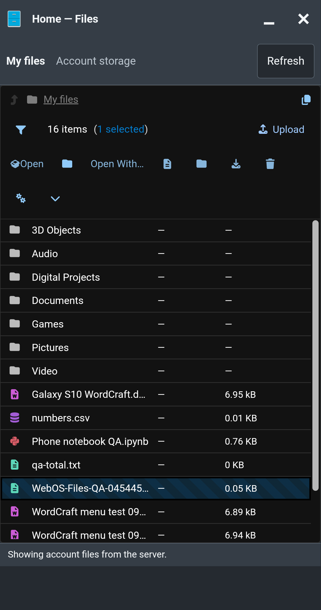

# Files phone qualification

Open **System Tools → Files** in WebOS. The installed Files code is `8062a13e`. It builds from `src/index.mjs` through the WebOS viewer builder. The signed-in view uses account storage and the guest view uses files scoped to one browser tab.

The phone baseline covers two of seven ordinary workflows. It exercises device upload and the handoff to an editor and back to Files. Browse and search, folder organization, download, conflict recovery and guest lifetime are separately tracked.

1. Sign in with a reusable QA account on a Samsung Galaxy S10+ in Chrome `158.0.8127.92` at 411 CSS pixels.
2. Tap Upload and use the native Android Files picker to select a synthetic `.txt` file from Downloads.
3. Tap the file and Open. Text Editor displays the uploaded text. Replace that text and select Save. Wait for **Saved to your account**.
4. Sign in again from a fresh browser context. Locate the file in My files and open it. The editor shows the exact revised text. Close the editor and minimize Files. The WebOS app bar returns.

Hosted desktop Chromium also uploaded and opened a temporary guest file. Its Files window identified browser-tab storage, and reloading the site removed the temporary file. The Files suite passed 34 checks. Account conflict recovery, move, download and other desktop workflows remain under qualification.
